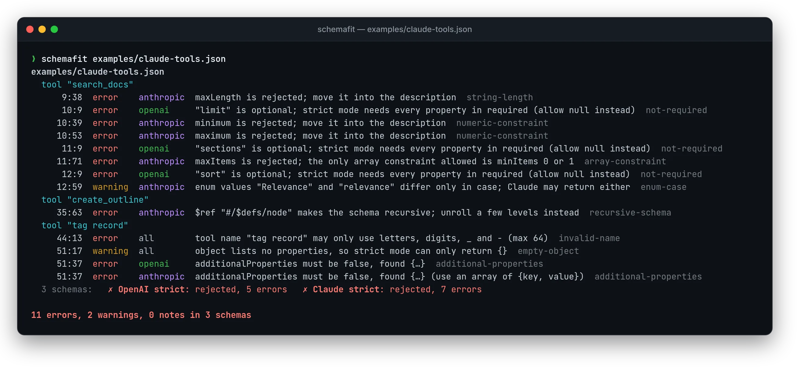

<p align="center">
  
</p>

<h3 align="center">Check a JSON Schema against OpenAI and Claude strict mode before the API returns a 400.</h3>

<p align="center">
  <a href="https://github.com/celaldrg/schemafit/actions/workflows/ci.yml"></a>
  <a href="https://github.com/celaldrg/schemafit/releases"></a>
  <a href="LICENSE"></a>
  
  
</p>

## Why

Structured outputs and strict tool calling are how agents get JSON they can trust: OpenAI's `strict: true` (Structured Outputs and function calling) and Claude's `output_config.format` and strict tool use both compile your schema into a grammar and force the model to follow it. Both also accept only a **subset** of JSON Schema, and the subsets are different.

A schema that works in one place fails in the other. A Pydantic model with an optional field is fine for Claude but OpenAI wants every property in `required`. `"format": "uri"` passes Claude and fails OpenAI. `minimum`, `maxLength` and `maxItems` pass OpenAI and fail Claude. A recursive tree is fine for OpenAI and rejected by Claude. Claude also caps a whole request at 24 optional parameters, 16 union-typed parameters and 20 strict tools, so a set of tools can fail even when every single tool is fine. You find out at runtime, from a 400.

`schemafit` reads your schemas (bare, inside a request body, in a tools array or in an MCP `tools/list` result) and tells you, with line and column, what each provider will reject. `schemafit fix` rewrites them to fit one provider.

- **Two rule sets**, from the providers' own documentation: OpenAI Structured Outputs and Claude structured outputs / strict tool use. Each finding says which provider it applies to.
- **Finds schemas anywhere**: bare JSON Schema, `response_format.json_schema`, Responses `text.format`, Claude `output_config.format`, OpenAI Chat and Responses tools, Claude tools, MCP `tools/list`.
- **Request-level budgets**: Claude's optional-parameter, union and strict-tool limits are counted across all schemas in a file; OpenAI's nesting, property, enum and string-size limits per schema.
- **`fix`**: adds `additionalProperties: false`, turns optional fields into required-and-nullable for OpenAI, moves unsupported constraints into the description for Claude (what the official SDK helpers do), and lists what still needs a human.
- Zero dependencies, one static binary. `--json` for CI and editors, `--strict` to fail on warnings.

<p align="center">
  
  <br><sub>Real output: <code>schemafit examples/claude-tools.json</code>. Three ordinary-looking tools, rejected by both providers for different reasons.</sub>
</p>

## Install

Download a binary from the [v0.1.0 release](https://github.com/celaldrg/schemafit/releases/tag/v0.1.0) (Linux, macOS, Windows; amd64 and arm64), or with Go:

```sh
go install github.com/celaldrg/schemafit@v0.1.0
```

Or from source:

```sh
git clone https://github.com/celaldrg/schemafit && cd schemafit
go build -o schemafit .
```

## Usage

```text
schemafit [options] <file | ->...        check schemas
schemafit fix --target <p> <file | ->    print the file rewritten to fit one provider

  --target <list>   providers to check: openai, anthropic (default: both)
  --json            machine-readable output
  --strict          exit 1 on warnings too
  --quiet           only show errors
  --no-color        disable colors (also NO_COLOR=1)
```

Exit codes: `0` fits, `1` problems found, `2` usage or read error.

```sh
schemafit schemas/*.json                       # every schema, both providers
schemafit --target openai request.json         # only OpenAI's rules
python -c 'import json, app; print(json.dumps(app.Invoice.model_json_schema()))' | schemafit -
```

## Example

<p align="center">
  
  <br><sub>Recorded with <a href="https://github.com/charmbracelet/vhs">vhs</a>: <code>schemafit examples/good.json</code>, <code>schemafit --quiet examples/invoice-request.json</code>, then <code>schemafit fix --target anthropic examples/claude-tools.json</code>.</sub>
</p>

[`examples/invoice-request.json`](examples/invoice-request.json) is a Chat Completions request with an invoice-extraction schema, the kind you get from a hand-edited Pydantic or Zod export:

```text
$ schemafit examples/invoice-request.json
examples/invoice-request.json
  response format "invoice extraction"
      6:15  error    all        format name "invoice extraction" may only use letters, digits, _ and - (max 64)  invalid-name
      8:17  error    openai     object needs "additionalProperties": false  additional-properties
      8:17  warning  anthropic  object needs "additionalProperties": false (SDK helpers add it, raw requests do not)  additional-properties
     11:49  error    anthropic  minLength is rejected; move it into the description  string-length
     14:11  error    openai     "website" is optional; strict mode needs every property in required (allow null instead)  not-required
     14:52  error    openai     format "uri" is not supported (date-time, time, date, duration, email, hostname, ipv4, ipv6, uuid)  unsupported-format
     15:11  error    openai     "currency" is optional; strict mode needs every property in required (allow null instead)  not-required
     16:40  error    anthropic  minimum is rejected; move it into the description  numeric-constraint
     17:11  error    openai     "notes" is optional; strict mode needs every property in required (allow null instead)  not-required
     17:40  warning  all        nullable is OpenAPI 3.0, not JSON Schema; write "type": ["<type>", "null"]  openapi-nullable
     22:15  error    openai     allOf is not supported; merge the parts into one object  unsupported-keyword
     23:17  error    anthropic  allOf with $ref is not supported; inline the referenced schema  allof-ref
     24:17  error    openai     object needs "additionalProperties": false  additional-properties
     24:17  warning  anthropic  object needs "additionalProperties": false (SDK helpers add it, raw requests do not)  additional-properties
     24:35  error    openai     "tax_rate" is optional; strict mode needs every property in required (allow null instead)  not-required
     35:56  error    anthropic  pattern "^(?!0+$)\\d{10,11}$" uses a lookaround, which is not supported  regex-feature
     44:48  error    anthropic  minimum is rejected; move it into the description  numeric-constraint
  1 schema:   ✗ OpenAI strict: rejected, 9 errors   ✗ Claude strict: rejected, 6 errors

14 errors, 3 warnings, 0 notes in 1 schema
```

[`examples/good.json`](examples/good.json) is the same data written to fit both:

```text
$ schemafit examples/good.json
examples/good.json
  1 schema:   ✓ OpenAI strict: fits   ✓ Claude strict: fits

0 errors, 0 warnings, 0 notes in 1 schema
```

### fix

`fix` prints the whole file with every schema rewritten for one provider. The change log and anything left over go to stderr:

```text
$ echo '{"type":"object","properties":{"city":{"type":"string"},"unit":{"type":"string","enum":["c","f"]}},"required":["city"]}' \
    | schemafit fix --target openai -
{
  "type": "object",
  "properties": {
    "city": {
      "type": "string"
    },
    "unit": {
      "type": ["string", "null"],
      "enum": ["c", "f", null]
    }
  },
  "required": ["city", "unit"],
  "additionalProperties": false
}
fixed  #: set additionalProperties: false
fixed  #: made unit required and nullable
fits openai strict mode (2 change(s))
```

For Claude, `fix` keeps optional fields optional and moves `minimum`, `maxLength`, `maxItems` and unsupported formats into the description as `{minimum: 1, maximum: 50}`, so the model still sees the constraint. Validate those values in your own code: the API no longer enforces them. `fix` does not touch what has no safe rewrite (`allOf`, recursion, `if`/`then`/`else`, invalid names); those are listed as `left`.

## What it checks

| Rule | OpenAI | Claude |
| --- | --- | --- |
| `root-not-object`, `root-any-of`: the root must be a plain object | error | |
| `additional-properties`: every object needs `"additionalProperties": false` | error | error if not false, warning if missing |
| `not-required`: every property must be in `required` | error | |
| `unsupported-format`: `format` outside the supported list (`uri` is Claude-only) | error | error |
| `unsupported-keyword`: `allOf`, `not`, `if`/`then`/`else`, `dependentRequired`, `dependentSchemas`; `patternProperties` for Claude | error | warning / error |
| `numeric-constraint`: `minimum`, `maximum`, `exclusiveMinimum`, `exclusiveMaximum`, `multipleOf` | | error |
| `string-length`: `minLength`, `maxLength` | | error |
| `array-constraint`: `maxItems`, `uniqueItems`, `contains`, `prefixItems`, `minItems` above 1 | | error |
| `recursive-schema`: a `$ref` cycle (`#/$defs/node` inside itself, or `#`) | | error |
| `allof-ref`, `complex-enum`, `regex-feature` (backreferences, lookaround, `\b`, large `{n,m}`) | | error / warning |
| `enum-case`: enum values that differ only in capitalization | | warning |
| `nesting-depth` (10), `too-many-properties` (5000), `enum-budget` (1000 values; 15,000 chars for enums over 250 values), `string-budget` (120,000 chars) | error | |
| `optional-budget` (24), `union-budget` (16), `strict-tool-budget` (20), counted across the file as one request | | error |
| `invalid-name`: tool and format names must match `^[a-zA-Z0-9_-]{1,64}$` | error | error |
| `external-ref`, `unresolved-ref`, `invalid-type`, `required-unknown`, `duplicate-key`, `invalid-json` | error | error |
| `openapi-nullable`, `undocumented-keyword`, `empty-object`, `boolean-schema`, `ref-siblings` | warning | warning |

For tool arrays, Claude's budgets count tools with `strict: true`. If no tool in the file is strict yet, all of them are counted, on the assumption that you are checking whether they can be.

## Use it in CI

```yaml
- uses: actions/setup-go@v5
  with:
    go-version: "1.22.x"
- run: go install github.com/celaldrg/schemafit@v0.1.0
- run: schemafit --target openai schemas/*.json
```

## Limits

- The rules follow the public documentation of [OpenAI Structured Outputs](https://platform.openai.com/docs/guides/structured-outputs#supported-schemas) and [Claude structured outputs](https://docs.claude.com/en/docs/build-with-claude/structured-outputs) as of November 2026. Providers change these limits; open an issue when one moves.
- Errors are rules the documentation states. Warnings are keywords the documentation does not list as supported; they may work, be ignored or be rejected.
- Claude also has internal grammar-size limits that are not published. A schema can pass every explicit check and still get "Schema is too complex for compilation".
- `schemafit` does not call either API, and it does not validate data against your schema.

schemafit is an independent project and is not affiliated with OpenAI or Anthropic.

## Related

- [mcptax](https://github.com/celaldrg/mcptax): what an MCP server's tools cost in context tokens
- [mcpdiff](https://github.com/celaldrg/mcpdiff): catch breaking changes in MCP tool schemas
- [toolrank](https://github.com/celaldrg/toolrank): rank MCP tools against a task
- [a2alint](https://github.com/celaldrg/a2alint): lint A2A Agent Cards

## License

[MIT](LICENSE)
